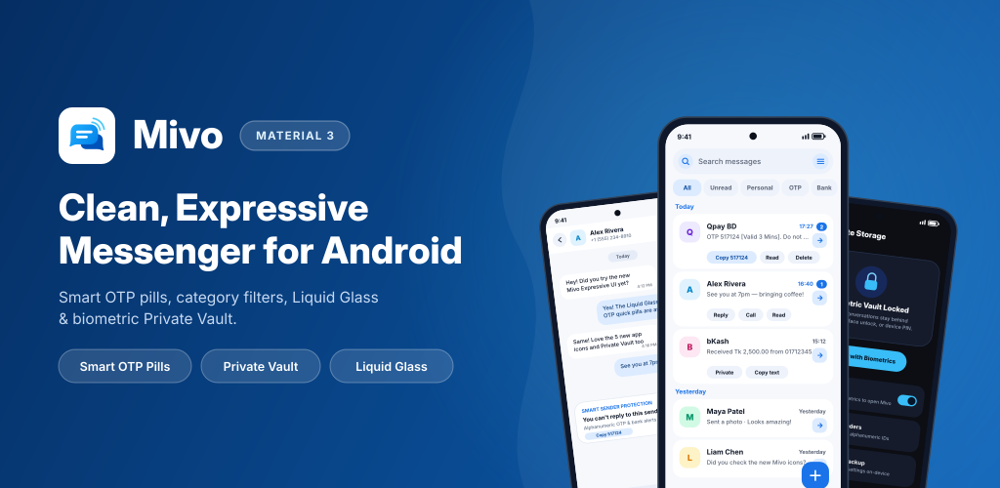
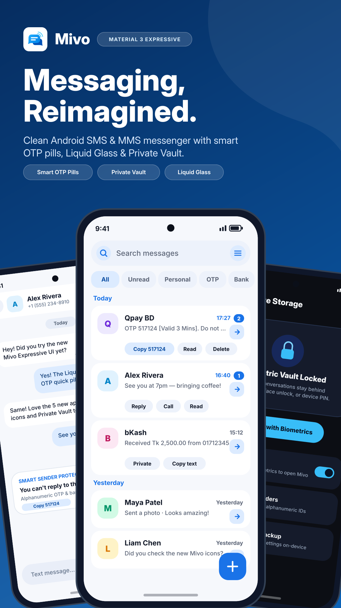
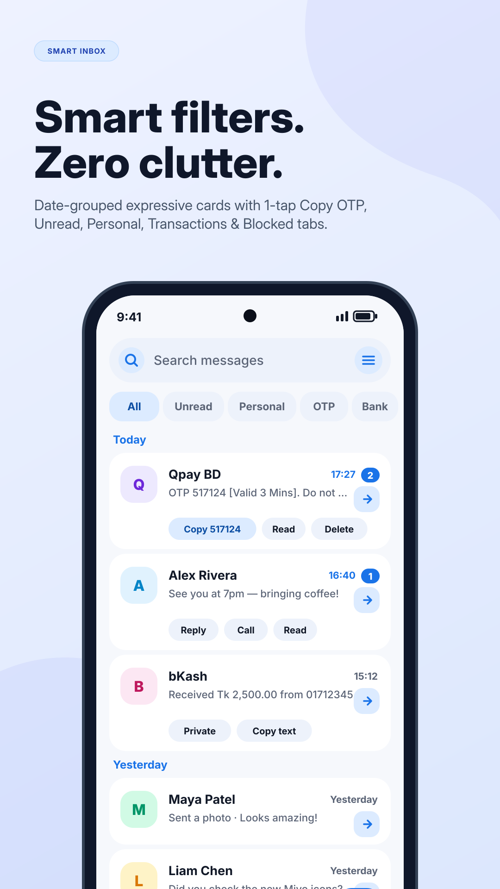
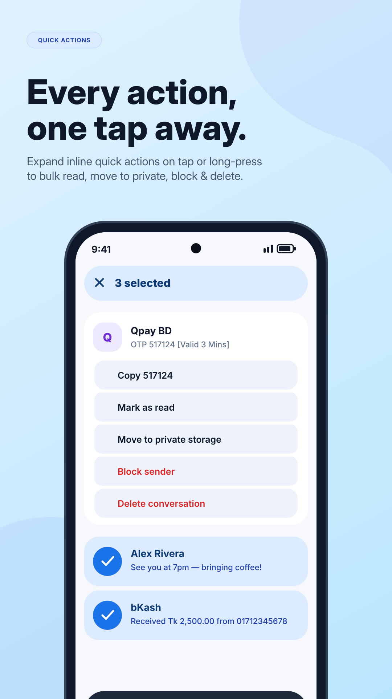
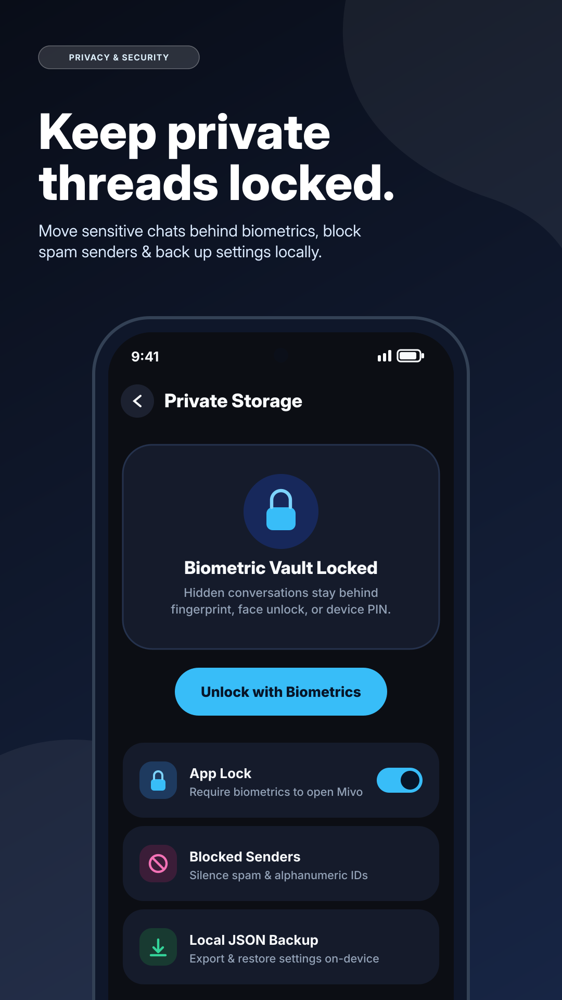
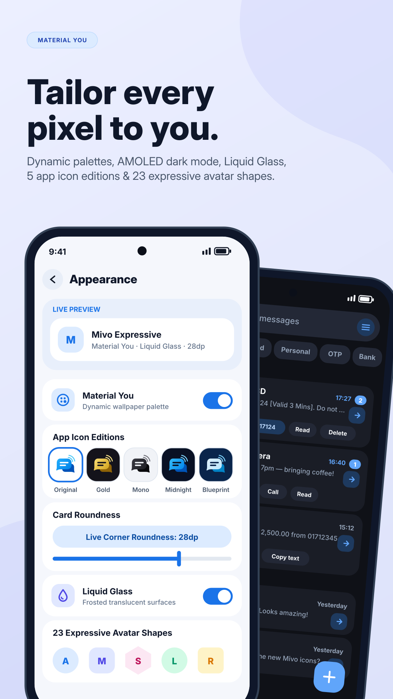

# Mivo

An SMS &amp; MMS messaging app for Android, built with Jetpack Compose.

  

  
  &nbsp;
  
  &nbsp;
  
  &nbsp;
  
   

> [!NOTE]
> Mivo is currently in **Google Play testing**. To install from **[Google Play](https://play.google.com/store/apps/details?id=com.grinch.mivo)**, join the **[Google Group](https://groups.google.com/g/rivophoneapp)** first (see [Joining Google Play Internal Testing](#joining-google-play-internal-testing) below). Beta APKs built from the latest code are posted under **[GitHub Releases](https://github.com/user-grinch/MivoMessages/releases)**. Feedback and bug reports are welcome on **[Discord](https://discord.gg/NtEvU3726e)**.

---

## Features

- **Category Filters**: Filter your inbox by All, Unread, Personal, Transactions, OTP, and Blocked.
- **Quick Action Pills**: Copy OTP codes, mark as read, reply, call, move to private storage, block, or delete directly from the message list. You can pick which buttons appear for each category.
- **Expandable Actions & Multi-Select**: Tap a thread for quick actions, or long-press to select multiple threads at once.
- **SMS & MMS**: Dual SIM support, MMS attachments, and automatic read-only handling for alphanumeric service senders.
- **Private Storage & App Lock**: Hide conversations or lock the app behind biometrics or device PIN.
- **Themes & Layout**: Material You colors, custom color picker, AMOLED dark mode, Liquid Glass style, 5 app icons, 23 avatar shapes, card roundness, fonts, and swipe actions.
- **Local Backup**: Export and restore your settings and blocklist as a local JSON file.

## Screenshots

  
  
  

  
  
  

---

## Downloads

- **Google Play (Testing)**: [Google Play](https://play.google.com/store/apps/details?id=com.grinch.mivo) *(join the [Google Group](https://groups.google.com/g/rivophoneapp) first)*
- **Beta**: [Mivo.apk](https://github.com/user-grinch/MivoMessages/releases/download/beta/Mivo.apk) ([all releases](https://github.com/user-grinch/MivoMessages/releases))
- **Discord**: [Join the server](https://discord.gg/NtEvU3726e)

### Joining Google Play Internal Testing

To access Mivo on Google Play during testing:

1. Join the [Google Group](https://groups.google.com/g/rivophoneapp) using the same Google account you use on the Google Play Store.
2. Open the [Google Play opt-in page](https://play.google.com/apps/testing/com.grinch.mivo) and select **Become a tester**.
3. Download and install Mivo from [Google Play](https://play.google.com/store/apps/details?id=com.grinch.mivo).

## License

Copyright &copy; 2025&ndash;2026 Grinch_. All rights reserved.
