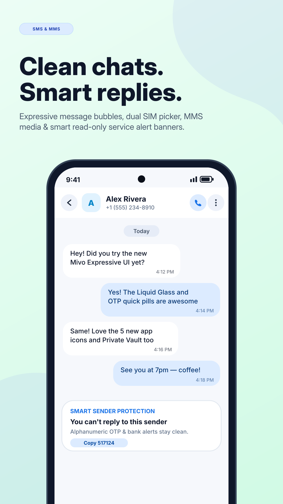

# Mivo

An SMS &amp; MMS messaging app for Android, built with Jetpack Compose.

  
  &nbsp;
  
  &nbsp;
  

---

## How to Download &amp; Get Updates

> [!IMPORTANT]
> **Mivo updates are currently only available on Google Play (Testing) for now.** GitHub APK releases are temporarily paused. Follow the steps below to join and install Mivo from Google Play:

1. **Join the Google Group** — Open the [Google Group](https://groups.google.com/g/rivophoneapp) and click **Join group** using the **same Google account** you use on the Google Play Store.
2. **Become a Tester** — Open the [Google Play opt-in page](https://play.google.com/apps/testing/com.grinch.mivo) and click **Become a tester**.
3. **Download from Google Play** — Open [Mivo on Google Play](https://play.google.com/store/apps/details?id=com.grinch.mivo) and tap **Install** *(if the page isn't available immediately, wait a moment and refresh)*.
4. **Receive Updates &amp; Share Feedback** — All future updates will arrive automatically through Google Play. Join our [Discord server](https://discord.gg/NtEvU3726e) to report bugs or share feedback.

---

  

## Features

- **Category Filters**: Filter your inbox by All, Unread, Personal, Transactions, OTP, and Blocked.
- **Quick Action Pills**: Copy OTP codes, mark as read, reply, call, move to private storage, block, or delete directly from the message list. You can pick which buttons appear for each category.
- **Expandable Actions & Multi-Select**: Tap a thread for quick actions, or long-press to select multiple threads at once to pin, archive, mark read, mute, or delete.
- **SMS & MMS**: Dual SIM support, MMS attachments, voice notes, scheduled messages, quick replies, starred messages, delivery reports, undo send, and automatic read-only handling for alphanumeric service senders.
- **Private Storage & App Lock**: Hide conversations or lock the app behind biometrics or device PIN.
- **Themes & Layout**: Material You colors, custom color picker, AMOLED dark mode, Liquid Glass style, 5 app icons, 23 avatar shapes, chat bubbles, card roundness, fonts, and swipe actions.
- **Encrypted Local Backup**: Export and restore your messages, settings, and blocklist as an encrypted local backup file.

## Screenshots

  
  
  

  
  
  

---

## License

Copyright &copy; 2025&ndash;2026 Grinch_. All rights reserved.
